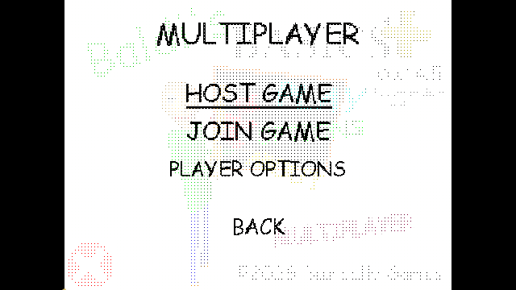

# Back from Multiplayer, 0.4.10

Back on the Multiplayer root or connected-room page now calls GlobalCam's native Dither transition when returning to the title. Esc at the root uses the same close path. Internal-page Back, gameplay return and programmatic level loading retain their existing behavior.

The outgoing page is rendered by a separate menu camera, so the native transition's default old-frame capture would capture the underlying title instead. Closing starts the native transition, renders the actual Multiplayer page into its target and copies that image into the native transition snapshot. It then hides the custom menu, restores its camera target, and reveals the purple title button. The existing incoming-title capture hook supplies the destination. Native dither timing and completion/cursor behavior remain in use.

The explicit `-bt-lab -bt-back-transition-tour` exercises actual Back component handlers. Six checks cover transition start, outgoing Multiplayer pixels, destination title artwork, progressively mixed pixels, restored cameras, and a connected room remaining hosted after Back. The dissolve capture is visually inspected. Physical mouse input is not automated. Both loader builds share the implementation; unrelated gameplay and transport suites are outside this UI change.

Anti-slop during-mode delivery gate: the user requested the game's existing dissolve on Back. Existing layout, supplied artwork and native motion are preserved; no new assets or decorative effects are introduced. Established ENERGY 1 / RHYTHM 1 / MOTION 1 remains the direction.
