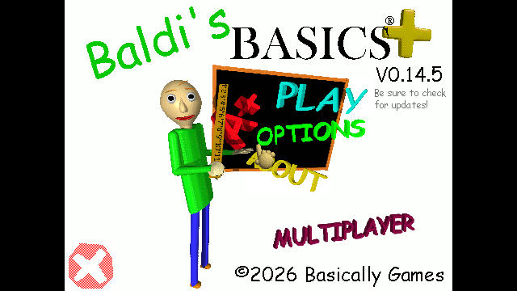

# Multiplayer title artwork, 0.4.8

The title button uses the user's supplied transparent purple MULTIPLAYER artwork. Both loaders embed the original PNG unchanged. A sprite rectangle removes its transparent margins for display; the 180x48 menu area preserves the image's aspect ratio above the publisher copyright.

The native StandardMenuButton stays on the raycast image itself so CursorController can find it. Hover slightly enlarges the image; pressing opens the existing Multiplayer menu through its native dissolve. A hidden child label retains the existing menu-font reference. Gameplay, player sprites and lobby rules are unchanged.

Four focused runtime checks verify the embedded sprite/transparency, native cursor raycast at the button center, the button's menu action and completion of the dissolve with the normal camera target restored. The title capture is visually inspected. This invokes actual component handlers and a native GraphicRaycaster, not physical mouse input. Both loaders compile; unrelated gameplay and transport tests are outside this UI change.

Anti-slop during-mode delivery gate: the user explicitly supplied the lettering and asked for it to replace the label. Existing native composition and menu behavior are retained. ENERGY 1 / RHYTHM 1 / MOTION 1 follows the established game-menu direction. Hover feedback identifies the clickable artwork. No new artwork, colors or layout sections were generated for this integration.
