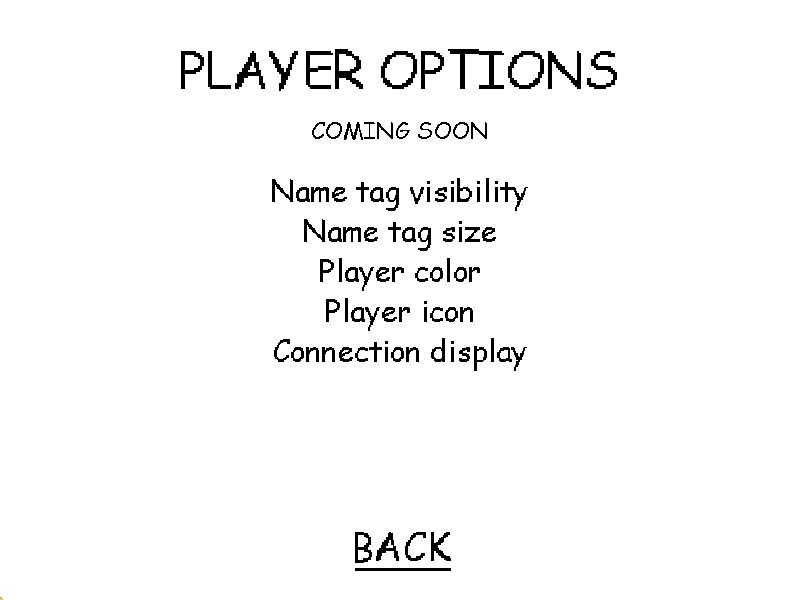
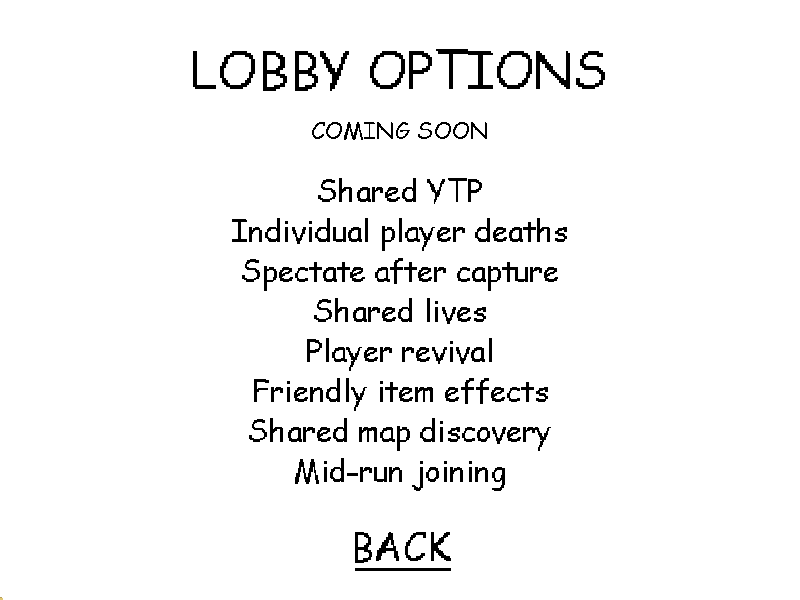

# Planned options UI, 0.4.7

Player Options is reachable from the Multiplayer main page before entering a room. Lobby Options is reachable inside the room. Back/Escape returns to the appropriate parent page and preserves an existing connection. F5 still closes the menu.

The lists are static text, marked Coming Soon. They have no toggles, stored values or network messages. Shared YTP, deaths, lives and spectating retain existing behavior. This update only adds UI for future features.

Player features: name tag visibility, name tag size, player color, player icon and connection display.

Lobby features: shared YTP, individual player deaths, spectate after capture, shared lives, player revival, friendly item effects, shared map discovery and mid-run joining.

Six focused runtime checks cover both pages, their Back actions, preserving player values/the room connection, and 800x600 label bounds. Captures were visually inspected. The tour invokes actual menu component handlers; it does not claim physical mouse automation. Both loaders compile from the same UI code. Gameplay and transport suites were not rerun for this UI-only change.

Anti-slop during-mode delivery gate: the user's direction is the existing Baldi menu with feature names only. ENERGY 1 / RHYTHM 1 / MOTION 1 follows that established direction. Existing font, white background, black labels and native navigation preserve the game's identity. Coming Soon explains the future scope; static names do not pretend to be working controls. No new artwork, palette, decorative motion or assets were generated. Both small-layout captures fit without clipping, and Back returns to the appropriate parent.
