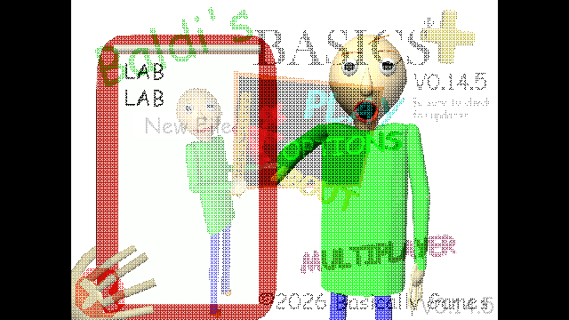

# Title artwork during transitions, 0.4.9

The artwork previously appeared after the title dissolve because it was added by a half-second menu scan. The button could also hide itself while its native menu parent was inactive, leaving it absent from a returning transition's capture. Preparing the object early alone was insufficient: the native dither could still read a render target containing the outgoing profile view before the new image's canvas geometry was built.

The mod now prepares the artwork from native MenuInitializer/MainMenu startup hooks, including inactive menu children. Its native parent controls title visibility, while the button's own active state is reserved for opening/closing Multiplayer. Title visibility checks the actual menu hierarchy and excludes the profile-selection canvas.

Immediately before the native Dither iterator reads its destination, an incoming visible title forces canvas geometry to update and renders that title camera. This makes the original native dither texture include the artwork. The capture hook skips the custom Multiplayer menu's opening path, which already supplies its own destination.

Five focused title-transition checks pass: preparation while inactive, purple artwork pixels in the initial destination, artwork in a dissolve frame, artwork in a return destination after hiding the parent, and exactly one title button. The captured dissolve was visually inspected. The return check exercises the native transition API and parent activation sequence; physical menu clicks are not automated. The separate button-art tour checks native raycasting, menu opening and completion of the Multiplayer dissolve. Both loaders share the implementation and compile; gameplay/network behavior is unchanged.

Anti-slop during-mode delivery gate: existing supplied artwork and native dither are preserved. No visual assets, palette, layout or extra decorative motion were added. The change fixes when the existing artwork participates in the game's transition. Established ENERGY 1 / RHYTHM 1 / MOTION 1 remains the direction.
