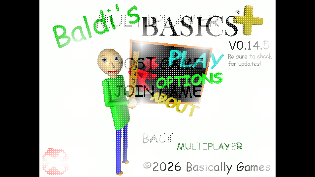

# Multiplayer opening transition, 0.4.4

The game's MainMenu.ActivateTransition calls GlobalCam.Transition with UiTransition.Dither. GlobalCam captures the old view immediately, captures the destination on the next frame and replaces pixels through its 16 native dither steps. The native step interval is 0.01666667 seconds, about 0.27 seconds overall.

Multiplayer previously rendered directly to the screen through its own camera, bypassing this effect. Opening Multiplayer from the title now starts the actual native transition before showing the menu. During the dissolve, the menu camera draws into GlobalCam's existing render target. The title camera pauses so it cannot overwrite the destination. Once GlobalCam finishes, the menu returns to its normal screen target and restores its pointer. Menu input waits during the dissolve. Gameplay F5 remains immediate.

An isolated BepInEx launch with `-bt-lab -bt-transition-tour` passed four focused checks: native transition starts, intermediate texture pixels change progressively, the destination contains the white Multiplayer menu, and the normal camera target/pointer return after completion. Captured intermediate and destination textures were visually inspected. Results are in artifacts/tests/transition-results.json. Both loaders compile from the same code; a physical mouse tour and unrelated network/gameplay suites were not rerun.

Anti-slop during-mode delivery gate: the user's direction is the existing game's menu motion. The native dither provides continuity with the title menu; no new art, typography, palette, layout or decorative motion was added. Existing menu identity and layout remain the direction, with ENERGY 1 / RHYTHM 1 / MOTION 1. The focused captures show the requested transition and intact destination. No new assets were generated.
